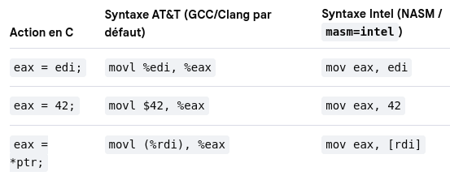

Subject Version 6

## Description

The goal is to make a static library from functions made in assembly using intel syntax.  

This library was intentionally made with the simplest set of instructions for the sake of simplicity.

AI was used to help debugging and to generate ft_simd_memchr.s instructions.

### Required steps to build the project:

This project requires:
- GNU Make
- NASM

Additionally to run `make test`:
- a C compiler with libc (preferably GCC or Clang)

<br>

To compile the libasm.a:  
Use `make` to create the library with the mandatory part functions only.  
Use `make bonus` to create the library with all included functions.

To compile the tests:
Use `make test` to create the libasm_tester executable to run tests.

The tester can run different batchs of tests:
- `./libasm_tester` runs mandatory + bonus functions.
- `./libasm_tester mandatory` runs only mandatory functions.
- `./libasm_tester bonus` runs only bonus functions.
- `./libasm_tester misc` runs internal functions tests (not required per the subject).

#### Required for the mandatory part:
- ft_strlen &rarr; `size_t strlen(const char *s)`
- ft_strcpy &rarr; `char *strcpy(char *dest, const char *src)`
- ft_strcmp &rarr; `int strcmp(const char *s1, const char *s2)`
- ft_write &rarr; `ssize_t write(int fd, const void *buf, size_t count)`
- ft_read &rarr; `ssize_t read(int fd, void *buf, size_t count)`
- ft_strdup &rarr; `char *strdup(const char *s)`
- ft_calloc &rarr; `void *calloc(size_t nmemb, size_t size)`

*Calling malloc is allowed*

We must handle eventual **syscall** errors and set **errno**.
*We are allowed the use of `extern ___error` or `errno_location`*


#### Required for the bonus part:
- ft_atoi_base &rarr; `int ft_atoi_base(char *str, char *base)`
- ft_list_push_front &rarr; `void ft_list_push_front(t_list **begin_list, void *data)`
- ft_list_size &rarr; `unsigned int ft_list_size(t_list *begin_list)`
- ft_list_sort &rarr; `void ft_list_sort(t_list **begin_list, int (*cmp)())`
- ft_list_remove_if &rarr; `void ft_list_remove_if(t_list **begin_list, void *data_ref, int (*cmp)(), void (*free_fct)(void *))`
- ft_simd_memchr &rarr; `void *ft_simd_memchr(const void *s, int c, size_t n)`


The list structure is given as:
``` c
typedef struct s_list
{
void 	*data;
struct 	s_list *next;
} t_list;
```

### Compiling & Linking

```bash
%dir: nasm -f elf64 -o test.o test.s	# compile to elf64 from test.s
%dir: ld test.o -o prog  				# link objects into an executable
%dir: ./prog  
hello, world!  
```

To explore the resulting file:
```bash
objdump -M intel -d -j .text prog  
xxd -a prog  
```

#### AT&T vs Intel syntax



NASM accept both .s (linux) and .asm (windows).

## Ressources

[ASM introduction](https://github.com/0xAX/asm/tree/master)  
[Syscall numbers in linux](https://github.com/torvalds/linux/blob/master/arch/x86/entry/syscalls/syscall_64.tbl)  
[x86-64 Reference Sheet (AT&T syntax)](https://web.stanford.edu/class/cs107/resources/x86-64-reference.pdf)  
[Intel x86 JUMP quick reference](http://unixwiz.net/techtips/x86-jumps.html)  
[Article about SIMD instructions](https://medium.com/hackernoon/harnessing-the-power-of-simd-sse-assembly-instructions-for-good-fdaa8ce34e9a)  
[SIMD Parallelism](https://en.algorithmica.org/hpc/simd/)  
[x86 Intrinsics Cheat Sheet](https://db.in.tum.de/~finis/x86%20intrinsics%20cheat%20sheet%20v1.0.pdf)  
[SIMD Registers](https://simplifycpp.org/articles/a0724/designing-an-x86-64-assembler-simd-registers-xmm-ymm-zmm/)  
[The Art of 64-bit assembly language (book by Randall Hyde)](https://kolegite.com/EE_library/books_and_lectures/%D0%9F%D1%80%D0%BE%D0%B3%D1%80%D0%B0%D0%BC%D0%B8%D1%80%D0%B0%D0%BD%D0%B5/The%20Art%20of%2064-Bit%20Assembly%2C%20Volume%201%20x86-64%20Machine%20Organization%20and%20Programming%20%28Randall%20Hyde%29%20%28z-lib.org%29.pdf)  
